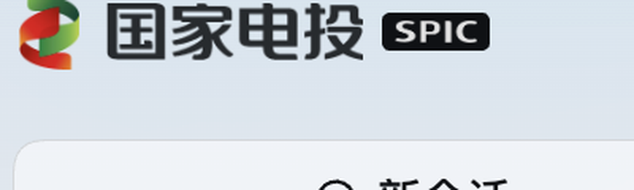

# dsh-spic-brand

把 DSH Web GUI 里的 DeepSeek 品牌标识换成**国家电投（SPIC）**品牌标识的纯客户端插件。



## 替换了什么

| 位置 | 原来的东西 | 现在 |
| --- | --- | --- |
| 侧栏品牌行 · 图形标 | 鲸鱼 `FishLogo` | 国家电投图形标（红绿丝带） |
| 侧栏品牌行 · 字标 | `deepseek` + 深色 `HARNESS` 胶囊 | `国家电投` 字标 + 深色 `SPIC` 胶囊 |
| 会话首屏 hero · 品牌标 | 鲸鱼（`HeroFish`） | 国家电投图形标 |
| 会话首屏 hero · 标语 | `探索未至之境` | `风光无限，国家电投` |
| 浏览器标签图标 | DSH 默认 favicon | 国家电投图形标 |
| 窗口标题 | `… — DeepSeek Harness` | `… — 国家电投` |

首屏「预览版」胶囊是 locale 文案（`hero.preview`），**不属于品牌标识，本插件不动它**。

hero 标语走的是 DOM 文本替换，不是 slot：那句文案由 `conversation` locale 命名空间渲染，而 locale 服务对同一 `ns/locale` 二次注册会抛错，注册表也没有 override 优先级，所以只能在 DOM 层纠正。为保证只改首屏、不误伤聊天记录或工作区名，替换被限制在「父元素 class 含 `titleGroup` 且自身无元素子节点」的纯文本 span 内。React 每次重渲染都会把原文写回，因此插件挂了一个 `MutationObserver` 持续纠正，而非只改一次。

## 为什么不会影响别的插件

- 只往 profile 的 boot graph 里 `insert` 自己一行，**不禁用、不覆盖任何官方或第三方插件**（`cordis.patch.yml` 里只有一条 insert）。
- 品牌槽位是 `single` 槽，DSH 的规则是「同 priority 注册会抛错，最小 priority 者渲染」。官方 `@deepseek-ai/dsh-client-ui-brand-official` 用默认 priority `0`，本插件用 `priority: -1` 遮盖它，**双方都保留在树上**。
- 想撤掉本插件，直接停用即可，官方品牌包立刻恢复可见，无需改回任何配置。
- 不碰全局 CSS 变量与主题 token，只挂一个 `style[data-plugin="dsh-spic-brand"]`，卸载时随 effect 一起移除。
- 形状跟随宿主：`sidebar.brand.mark` 给的是 `size`（正方形边长），窄侧栏 rail 传 24、hero 传 34，本插件按 `size × 83/104` 算出高度自适应，不改动宿主排版。

## 目录

```
assets/            从国家电投 logo 切出的四张图
  mark.png         图形标，83×104 透明
  cn.png           「国家电投」字标，白底 + 墨迹 alpha（供 CSS mask 上色）
  spic.png         「SPIC」字标，同上
  lockup.png       图形标 + 两行字标的合体，备用
src/client.template.js   浏览器半侧源码模板（占位符待注入 data-URI）
lib/client.js            构建产物，真正被加载的文件
lib/index.js             宿主半侧，空 apply 占位
scripts/gen-assets.py    从原始 logo 切图
scripts/build-client.mjs 把图片转 data-URI 并注入模板
scripts/verify-client.mjs 离线契约自检（不开浏览器）
cordis.patch.yml         随包分发的 bundle patch
```

## 构建与自检

```bash
node scripts/build-client.mjs   # 重新生成 lib/client.js
node scripts/verify-client.mjs  # 校验 loader 契约 / priority / 渲染形状
python3 scripts/gen-assets.py   # 只有换 logo 源图时才需要
```

`verify-client.mjs` 会检查最容易把 GUI 搞崩的几件事：factory 返回的是不是带 `apply` 的对象、三个 slot 是不是都用 `priority: -1` 注册、组件在给 / 不给 `size` 时是否都渲染出预期结构、hero 标语改写是否只命中标语而未误改「预览版」胶囊。全部检查在 `node:vm` 沙箱里跑假 DOM，不需要浏览器。

## 素材来源与商标

`assets/` 下四张图从国家电投官方 logo（470×150 白底 PNG，图形标 x26–108、字标 x127–302）
切出，切图脚本 `scripts/gen-assets.py` 里记录了精确的裁切框。配色沿用国家电投视觉规范：
绿 `#00833E`、红 `#C7000B`、橙 `#F18C00`、藏蓝 `#1C1F61`。

**代码按 MIT 授权，但「国家电投」「SPIC」字样与丝带图形标是该集团的商标与品牌资产，
不在 MIT 授权范围内**，只应在标识该集团自有部署时按集团品牌规范使用。源 logo 原件
不入库（见 `.gitignore`），仓库里提交的是切好的成品图。

## 安装

### 方式一：插件管理器（推荐，桌面端唯一可行路径）

打开 Harness Web 侧栏的「插件」→「添加插件」，输入任一项后点「安装」，装完选「启用」：

| 输入 | 值 |
| --- | --- |
| GitHub 仓库地址 | `https://github.com/beng003/dsh-spic-brand` |
| npm 包名 | 尚未发布到 npm，暂不可用 |
| 本地插件目录 | 你 clone 下来的目录绝对路径 |

装好后**刷新页面**（Cmd/Ctrl+R）即生效。

> 桌面端 profile 由 Electron 应用独占托管，`dsh plugin --profile desktop …` 会报
> `profile "desktop" is managed exclusively by the Electron application`。
> 桌面用户请在应用内的插件管理里装；下面的 CLI 方式适用于自建 profile。

### 方式二：命令行（自建 profile）

```bash
git clone https://github.com/beng003/dsh-spic-brand.git
dsh plugin add ./dsh-spic-brand
```

### 方式三：本地开发

```bash
git clone https://github.com/beng003/dsh-spic-brand.git
cd dsh-spic-brand
npm run build      # 重新生成 lib/client.js（改 src/client.template.js 后必须跑）
npm run verify     # 离线契约自检，不需要浏览器
```

插件在 profile 里以硬链接 / 软链形式引用，改完 `lib/client.js` 后刷新页面即可看到变化，
不必重新安装。

### 环境要求

- DeepSeek Harness `0.2.0-rc.2` 或与其 slot 契约兼容的版本。
- 依赖的宿主槽位：`sidebar.brand.mark`、`sidebar.brand.name`、`conversation.hero.brand.mark`，
  注册代码在 `src/client.template.js` 的 `apply(ctx)` 里（约 197–202 行）。
  宿主若改了槽名，插件会静默失效而非报错——届时改那三行的槽名字符串并重新构建即可。
- 无需任何运行时依赖，浏览器半侧是手写 lazy-CJS，图片以 data-URI 内联。

## 卸载

在插件管理里停用即可。官方 `@deepseek-ai/dsh-client-ui-brand-official` 从未被禁用或移除，
停用后侧栏立刻恢复鲸鱼标识，无需改回任何配置。

## 许可

MIT
